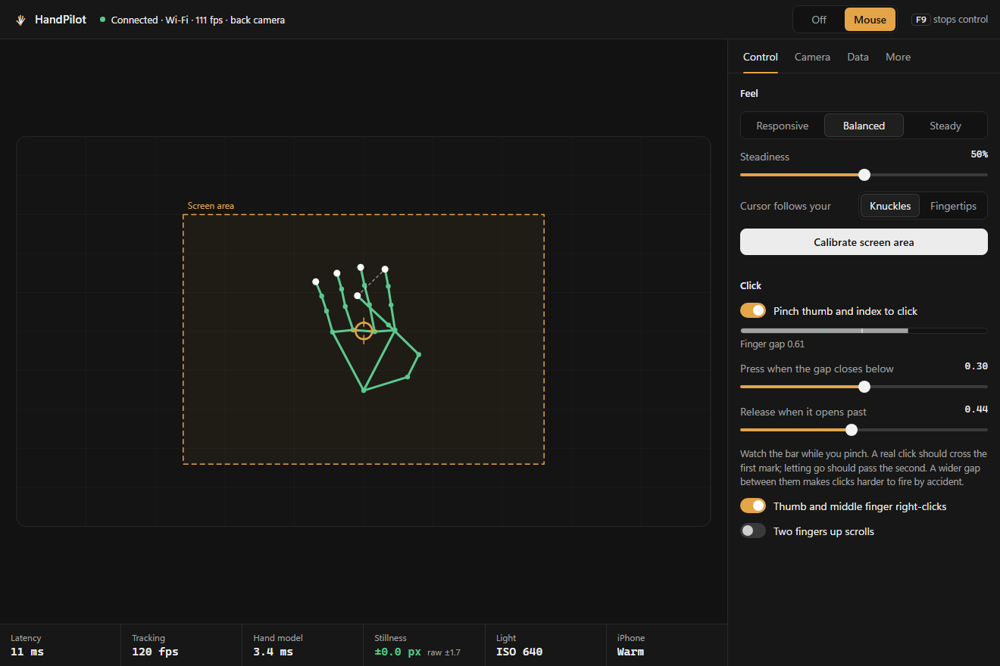

# HandPilot

Hand tracking with your iPhone's camera, streamed to your computer over a USB cable at up to 120
frames a second. Use it as a mouse, or read the 21 joint positions from your own code.



Hand tracking with my laptop's webcam always felt laggy and smeared. The same idea running on my
iPhone felt instant. Part of that is Apple's hand model running on the phone's Neural Engine, but
mostly it's the camera: 120 frames a second instead of 30, and a 1/500 s shutter instead of about
1/30 s, so a moving hand stays sharp. The phone sends only the joint positions, 291 bytes a frame.
No video leaves the phone.

## Getting started

You need an iPhone on iOS 17 or later, a Windows PC with Python 3.10 or later, and a cable.

1. Build and install the iPhone app. You don't need a Mac: [docs/ios-build.md](docs/ios-build.md)
   covers Codemagic, GitHub Actions and Xcode.
2. On Windows, install Apple Devices from the Microsoft Store (it brings the USB driver) and open it
   once with the phone plugged in.
3. Download this repository and run `python run.py`. Nothing else to install.
4. Open HandPilot on the phone, tap Start, and stand it about a forearm's length away with the camera
   facing you. In the window, click Calibrate, sweep your hand over the area you want to use, then
   switch to Mouse.

Pinch thumb and index to click, and hold the pinch to drag. F9 stops everything, from anywhere.

## Just the data

Close the window, then:

```python
from handpilot import HandStream

with HandStream() as hands:
    for frame in hands:
        if frame.hand:
            print(frame.landmark("index_tip"))   # (x, y, confidence)
```

`python run.py --stream` prints the same thing as JSON lines, and works on macOS and Linux too.
With the window open, its Data tab can forward every frame over UDP or to a web page.
[docs/data.md](docs/data.md) has the formats.

## Good to know

- It needs light. The fast shutter that keeps your hand sharp also gathers less light, and a dim
  room shows up as a noisy image and a restless cursor.
- Pointing in mid-air is less precise than a mouse, and your arm gets tired. It's best for
  presenting, couch control, demos and creative coding.
- Apps installed with a free Apple ID stop opening after 7 days. Run Sideloadly again to refresh;
  your settings are kept.
- Mouse control is Windows-only for now. The data stream works anywhere.

There's more in the [user guide](docs/using.md) and in [how it works](docs/how-it-works.md), which
covers the latency budget and how the jitter was tamed.

## Similar projects

[Gesture](https://github.com/Gesture-App/gesture) drove a computer's mouse from an iPhone over
Bluetooth back in 2022. [TrackOSC](https://github.com/JGL/TrackOSC) and
[VisionOSC](https://github.com/LingDong-/VisionOSC) stream Apple Vision results to creative tools over
OSC, and [Record3D](https://github.com/marek-simonik/record3d) streams iPhone depth video over USB.
HandPilot is about latency: a high frame rate, a fast shutter, the model next to the sensor, and a
cable instead of Wi-Fi.

MIT licensed. Contributions are welcome; see [CONTRIBUTING.md](CONTRIBUTING.md).
